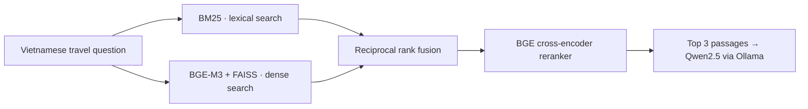

<h1 align="center">Vietnamese Tourism RAG</h1>

<p align="center"><strong>A Vietnamese travel assistant and a reproducible audit of its evidence retrieval.</strong></p>

<p align="center">
  <a href="#verify-the-research">Verify the research</a> &nbsp;·&nbsp;
  <a href="#run-the-assistant">Run the assistant</a> &nbsp;·&nbsp;
  <a href="#data-and-attribution">Data and attribution</a>
</p>

The assistant retrieves Vietnamese tourism passages and uses a local language
model to answer questions from the selected evidence. The research asks where
that process breaks at a fixed candidate budget. **Evidence availability**
means that the candidate pool contains a sufficient passage. **Evidence
selection** means that the reranker places one first.

## What the audit found

| Evaluation | Finding | Saved evidence |
| --- | --- | --- |
| **140 Vietnamese development questions** | The legacy top five contained sufficient evidence for **45** questions. With the same M0 reranker and five-passage budget, the symmetric Unicode BM25 configuration raised confirmed first-rank selections from **43** to **at least 92**. The new ranks are partially judged. | [Fixed-budget results](research/fixed_budget_20261121/results_summary.json) |
| **90 timetable-derived direction reversals** | At seed 42, both matched-budget rerankers identified the correct trip in both directions for **87/90** pairs when each competed only with its reverse. With three added distractors, M0 succeeded on **85/90** and M1 on **13/90**. | [Direction-reversal results](research/condition_checks_20261123/travel_constraint_swap_20261121/followup_results.json) |
| **24 archived Vietnamese reader questions** | **20/24** original pools contained sufficient evidence. Pretrained BGE and each M0 seed ranked sufficient evidence first for **20/20** available cases. M1 did so in **8–10/20** across three seeds. Replacing the fifth candidate on the four missing cases yielded **3/4** for pretrained BGE and **0/4** for each M1 seed. | [Reader results and score files](research/condition_checks_20261123/tourism_reader_target_20261123/) |

M0 and M1 use the same training budget. M0 repeats baseline rows in the extra
positions, and M1 uses the recorded augmentation bundle. The outcomes above
measure retrieval and single-passage evidence selection before answer generation.
See the linked results for the cohort definitions, uncertainty and judgment
protocols.

## Verify the research

The latest reader audit (Supplementary Section S20) can be checked using only
Python and the files in this repository. Run this from the repository root.

```bash
python research/condition_checks_20261123/tourism_reader_target_20261123/verify_saved_reader_scores.py
```

The verifier checks hashes, recomputes all 224 ranked outcomes from archived
scores and confirms the counts in Supplementary Table S22. It also checks the
cohort index for the **60 distinct reader questions** across the archived panels.
The 24-question row above refers to the latest panel alone.

| Research directory | What it contains |
| --- | --- |
| [Evidence-selection recovery](research/recovery_20261113/README.md) | Human-judged development pools, evidence insertion on 95 queries, loss controls, WikiQA and saved-score verifiers |
| [Fixed-budget retrieval](research/fixed_budget_20261121/README.md) | Vietnamese tourism, Travel Stack Exchange and Vietnamese MLQA comparisons, with protocols and aggregate outputs |
| [Condition-sensitive checks](research/condition_checks_20261123/README.md) | Timetable direction tests, reader cohorts, saved logits and the runnable S20 verifier |
| [Benchmark development](research/README.md) | Source-grouped drafts, review packets and provenance checks |

## Run the assistant



### 1. Prepare Python and the local assets

Use a Python 3.11 or 3.12 virtual environment. From the repository root, create
it with `python -m venv .venv`. Activate it with `source .venv/bin/activate` on
Linux or macOS, or `.\.venv\Scripts\Activate.ps1` in Windows PowerShell.

Install the following dependencies for a CPU setup. For a CUDA setup, choose
the PyTorch build that matches your environment. [PyTorch installation guide](https://pytorch.org/get-started/locally/)

```bash
python -m pip install torch==2.5.1 --index-url https://download.pytorch.org/whl/cpu
python -m pip install "pandas>=2.2,<3" "transformers==4.57.6" sentence-transformers faiss-cpu underthesea streamlit flask requests
```

| Asset | Expected location |
| --- | --- |
| Tourism passages and BM25 index | `data/processed/vietnam_tourism_rag_dataset.csv` and `data/processed/inverted_index.json` |
| Local reranker checkpoint, tokenizer and config | `models/run_3/vietnam_tourism_reranker_moc_13_seed_42/` |
| FAISS index | `data/vectors/faiss_index.bin` |

The corpus CSV and lexical index are tracked in this checkout. Supply the
local reranker files at the path above. On first launch, the app loads
`BAAI/bge-m3` and builds the FAISS index if it is missing. That first build
embeds the full corpus. [Pipeline entry point](src/run.py)

### 2. Start Ollama and open the app

Start Ollama locally on port `11434`. Then pull the model used by the
application and start Streamlit. [Ollama](https://ollama.com/)

```bash
ollama pull qwen2.5:14b-instruct-q4_K_M
python -m streamlit run app.py
```

Open `http://localhost:8501` and try **“Kinh nghiệm đi Vịnh Hạ Long”**. To use the
Flask interface, run `python app/local_backend.py` and open
`http://127.0.0.1:5000`. [Streamlit entry point](app.py) · [Flask entry point](app/local_backend.py)

## Data and attribution

- **Retrieval corpus.** The archived Vietnamese tourism corpus contains **56,984 chunks** from **4,122 distinct source URLs** at the Vietnam National Authority of Tourism. [Vietnam National Authority of Tourism](https://vietnamtourism.gov.vn/)
- **Reranker training data.** The 7,618 baseline reranking pairs were derived from **Vietnam Tourism V2**, released by **Vương Nguyễn Đình** (`vuonglsts`) on Kaggle. [Vietnam Tourism V2](https://www.kaggle.com/datasets/vuonglsts/vietnam-tourism-v2)
- **Evaluation sources.** The linked protocols record the source snapshots and judgment schemes for the external and reader evaluations. The original texts follow their source terms, and the checked-in audit exports provide IDs, labels and scores for the documented reanalyses. [Data provenance and terms](research/recovery_20261113/DATA_TERMS.md)

The project code is available under the [MIT License](LICENSE).
